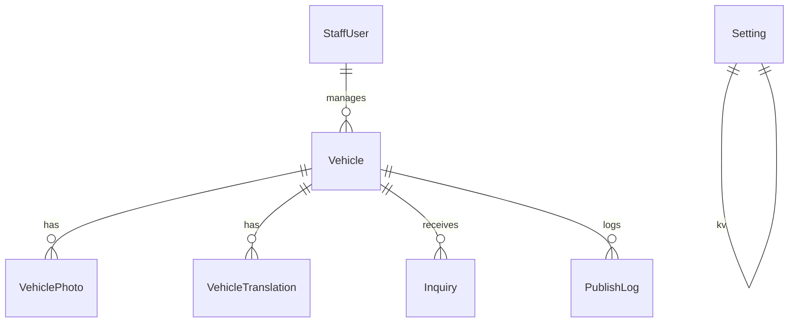

# Data model

Prisma schema: `prisma/schema.prisma`. Provider **sqlite** for local (`DATABASE_URL="file:./dev.db"`). No Prisma enums (string fields) so the same schema can switch to **postgresql** for Neon by changing `datasource.provider` and the URL.

## Entities

| Model | Purpose |
| --- | --- |
| `StaffUser` | email, name, passwordHash |
| `Vehicle` | slug, status, category, brand, model, version, year, mileageKm, fuel, gearbox, priceTtcCents, priceHtCents, warranty, descriptionFr, leboncoinUrl, facebookPostId |
| `VehiclePhoto` | url, alt, sortOrder |
| `VehicleTranslation` | locale `de` \| `en`, description ; unique (vehicleId, locale) |
| `Inquiry` | type rdv/essai/achat/reprise, contact fields, rgpdConsent, emailed |
| `PublishLog` | channel facebook/leboncoin, status success/error/prepared |
| `Setting` | key/value (facebookPageId, facebookPageToken) |

Prices are stored in **cents**. Utilitaires often have HT + TTC; voitures usually TTC only.

## Status effects

See [admin.md](admin.md). Public queries: `status IN (published, reserved)`.
