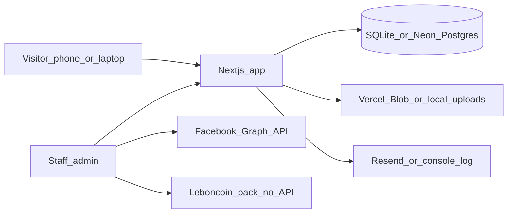

# Architecture overview

Garage de la Largue is a family Renault agent in Seppois-le-Bas. This system replaces the broken garagedelalargue.fr site with one Next.js app: a mobile-first public site (FR/DE/EN) and a small staff admin for used-car stock and publishing.

## Context



Actors:

- **Visitors** browse stock, workshop, rental, contact; submit RDV / essai / achat / reprise.
- **Staff** (2–3 logins) manage vehicles, photos, translations, Facebook post, LeBoncoin pack.
- **Facebook Page** “Garage De La Largue” receives one-click posts when a Page token is configured.
- **LeBoncoin Pro** is never automated: staff copy prepared text, download photos, confirm the ad, paste the URL back.
- **Email** goes to accueil@garagedelalargue.com via Resend when `RESEND_API_KEY` is set; otherwise the inquiry is stored and logged.

## Containers

| Container | Role |
| --- | --- |
| Next.js 16 App Router | SSR public pages, `/admin`, API routes, server actions |
| Prisma | Vehicles, photos, translations, inquiries, staff, settings, publish logs |
| File store | `public/uploads` locally; Vercel Blob in production |
| Meta Graph API v21 | Unpublished photos then Page feed post |
| DeepL | Optional FR → DE/EN of vehicle descriptions |
| Resend | Transactional mail for forms |
| Vercel | Hosting, HTTPS, domain garagedelalargue.fr |

## Folder map

```
app/[locale]/          public routes (fr, de, en)
app/admin/             staff UI (no locale prefix)
app/api/               auth, upload, facebook, leboncoin-pack, translate, inquiries
components/public/     header, sticky bar, cards, forms
components/admin/      vehicle form, photos, publish panel
lib/                   prisma, hours, facebook, leboncoin, deepl, email, garage facts
messages/              next-intl JSON
prisma/                schema + seed (~11 LeBoncoin-inspired ads)
docs/                  this tree
```

## Request flows

**Public listing** — middleware prefixes locale → `getPublicVehicles` (status `published` or `reserved`) → cards.

**Fiche** — slug lookup; `sold` and `draft` are 404; description falls back to FR if DE/EN missing.

**Forms** — server action `submitInquiry` validates Zod + RGPD checkbox, writes `Inquiry`, emails or logs.

**Admin create** — credentials session → Prisma insert (`draft` by default) → photos via `/api/admin/upload` → status `published` makes it live.

**Facebook** — POST `/api/admin/vehicles/:id/facebook` uploads unpublished photos, creates a feed post with caption + fiche link, stores `facebookPostId`.

**LeBoncoin pack** — GET pack JSON (title/description), optional zip of photos, open deposit URL, save ad URL on the vehicle. No scraping.

## Status machine

`draft` → `published` → `reserved` → `sold`

- `draft` / `sold`: hidden on the public site
- `published`: listed and fiche visible
- `reserved`: listed with a badge; fiche still visible

## Auth boundary

`/admin` (except login) requires Auth.js JWT session. Public routes never see staff cookies as a gate. Legal pages are public and French-only.

## Failure modes

| Failure | Behaviour |
| --- | --- |
| Facebook token missing / expired | Button disabled; setup copy in admin + env-vars.md |
| DeepL missing / down | Clear error; DE/EN textareas remain editable |
| Image upload without Blob token | Files written under `public/uploads` |
| Resend missing / error | Inquiry still persisted; payload logged to console |
| SQLite file missing | `npm run db:setup` creates it |
